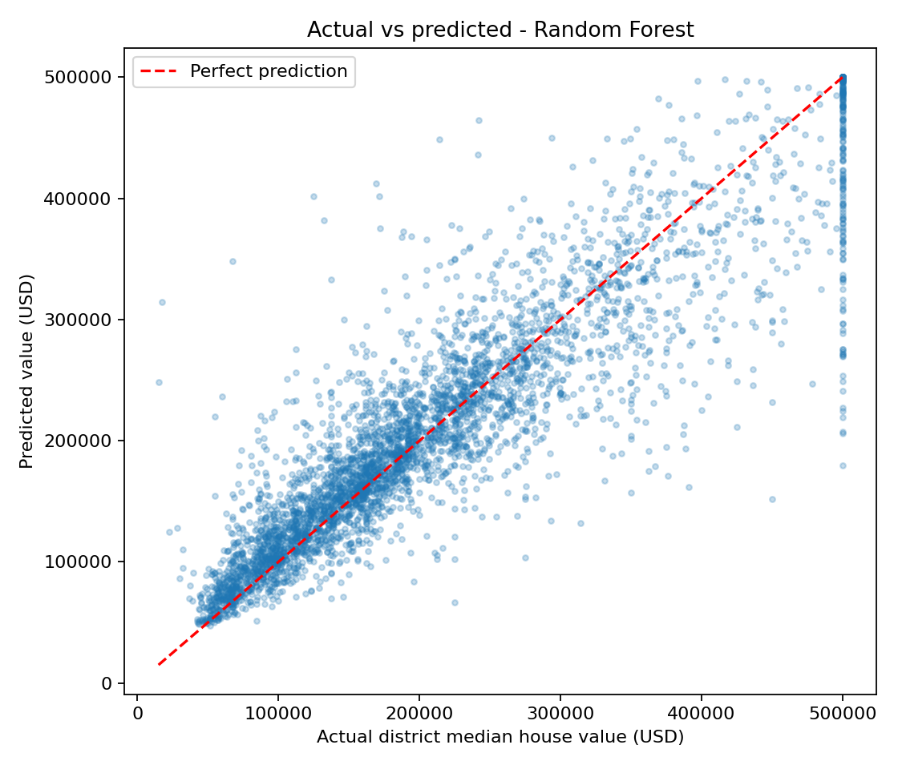
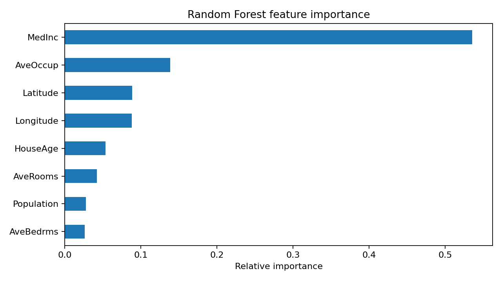
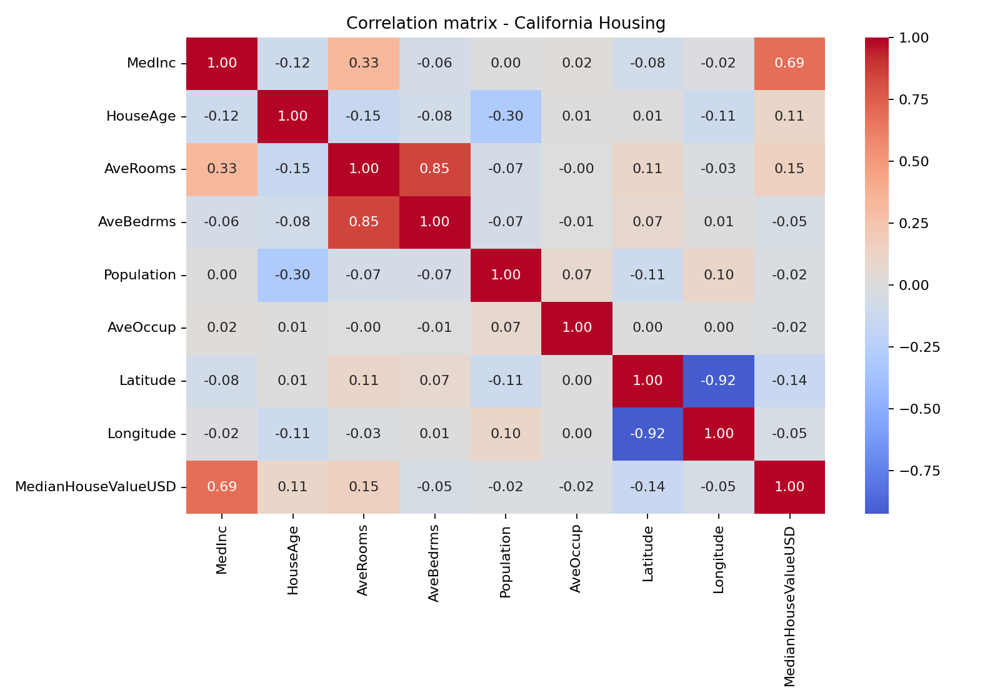

# House Price Prediction Using Machine Learning

**Project 1 — Structured Data | Python · scikit-learn · Google Colab**

This academic project uses **structured/tabular data** to train and compare **Linear Regression** and **Random Forest Regression** for predicting *median house value by California census block group*. Unlike a single-house listing-price predictor, this experiment uses the historical **California Housing** dataset derived from the **1990 U.S. Census**.

## Project overview

- **Task:** Supervised machine learning, regression.
- **Dataset:** California Housing from scikit-learn; **20,640 samples**, **8 input features**, and one regression target.
- **Split:** **80% training (16,512)** and **20% testing (4,128)**, `random_state=42`.
- **Training:** Both models are fitted using `.fit(X_train, y_train)`; **this project trains the models**. No pretrained regression weights are used.
- **Preprocessing:** Median imputation for both models, with feature scaling additionally applied to Linear Regression in a training-only pipeline.
- **Prediction target:** Median house value in **USD**. The original scikit-learn target is multiplied by **100,000** to express the values in USD.
- **Evaluation:** MAE, RMSE and R² on the held-out test set.

## Results

The following results were taken from `results/model_comparison.csv` produced by the completed notebook. The values were independently recomputed from the **4,128** rows in `results/test_predictions.csv`.

| Model | MAE (USD) ↓ | RMSE (USD) ↓ | R² ↑ |
|---|---:|---:|---:|
| Linear Regression | 53,320.01 | 74,558.14 | 0.5758 |
| **Random Forest** | **32,634.54** | **50,457.78** | **0.8057** |

**Random Forest achieved the lower MAE** on this particular train/test split and is saved as the selected model. An R² score of 0.8057 **does not mean 80.57% prediction accuracy**.

### Actual vs predicted



### Random Forest feature importance



### Correlation heatmap



## Run the project (Google Colab)

1. Open [Google Colab](https://colab.research.google.com/).
2. Choose **File → Upload notebook** and select `Project1_House_Price_Prediction_Code_Only.ipynb` from this repository.
3. Run all cells from top to bottom. **A GPU is not required**.
4. The first run downloads the California Housing dataset through scikit-learn; an internet connection is needed if it is not already cached.
5. The notebook trains both models, prints their evaluation metrics, creates charts and CSVs, saves the best pipeline, and offers to download `project1_results.zip`.

For a local Python environment, install dependencies:

```bash
python -m pip install -r requirements.txt
```

Then open the notebook with Jupyter or another compatible notebook environment.

## Repository contents

```text
House-Price-Prediction-ML/
├── Project1_House_Price_Prediction_Code_Only.ipynb  # Original 10-cell code-only notebook
├── README.md
├── requirements.txt
├── .gitignore
├── results/
│   ├── model_comparison.csv
│   ├── test_predictions.csv
│   ├── feature_importance.csv
│   ├── actual_vs_predicted.png
│   ├── feature_importance.png
│   └── correlation_heatmap.png
├── models/
│   └── README.md
└── scripts/
    └── verify_results.py
```

The notebook itself is deliberately **code only**, as requested; explanations are in this README. The `results/` directory holds the original exported figures and evaluation data, not invented example metrics.

### Verify the published metrics

```bash
python scripts/verify_results.py
```

This script recomputes MAE, RMSE and R² directly from `results/test_predictions.csv` and checks that all values match `results/model_comparison.csv`.

## Implementation details

- **Linear Regression:** `SimpleImputer(strategy="median")` → `StandardScaler()` → `LinearRegression()`.
- **Random Forest:** `SimpleImputer(strategy="median")` → `RandomForestRegressor(n_estimators=100, max_depth=20, min_samples_leaf=2, random_state=42, n_jobs=-1)`.
- **Model selection:** The notebook chooses the model with the lowest MAE on its held-out test set; on this experiment, that is Random Forest.
- **Saved model:** The pretrained artifact is intentionally not included in this lightweight GitHub package. Running the notebook trains both models and exports the selected trained model; see [models/README.md](models/README.md) for details.

## Limitations

- The source dataset is historical (1990), so predictions must **not** be presented as current house prices.
- Predictions concern **median housing value for a geographic area**, not the price of an individual property.
- A random train/test split does not measure performance on entirely unseen regions; geographic similarity may make evaluation optimistic.
- The notebook does not perform cross-validation or hyperparameter search. Selecting a winner by test MAE should be treated as an exploratory comparison; rigorous model selection would use a separate validation set or cross-validation.
- These metrics are specific to the supplied 4,128-row test set and should not be described as a guarantee of future performance.

## References

1. scikit-learn, [California Housing dataset description](https://scikit-learn.org/stable/datasets/real_world.html#california-housing-dataset).
2. scikit-learn, [`fetch_california_housing` API reference](https://scikit-learn.org/stable/modules/generated/sklearn.datasets.fetch_california_housing.html).
3. scikit-learn, [`LinearRegression` documentation](https://scikit-learn.org/stable/modules/generated/sklearn.linear_model.LinearRegression.html).
4. scikit-learn, [`RandomForestRegressor` documentation](https://scikit-learn.org/stable/modules/generated/sklearn.ensemble.RandomForestRegressor.html).

## Project status

**Completed academic prototype.** Code, training outputs, and evaluation data are provided for inspection and reproduction. The dataset is fetched through scikit-learn instead of being redistributed in this repository.
